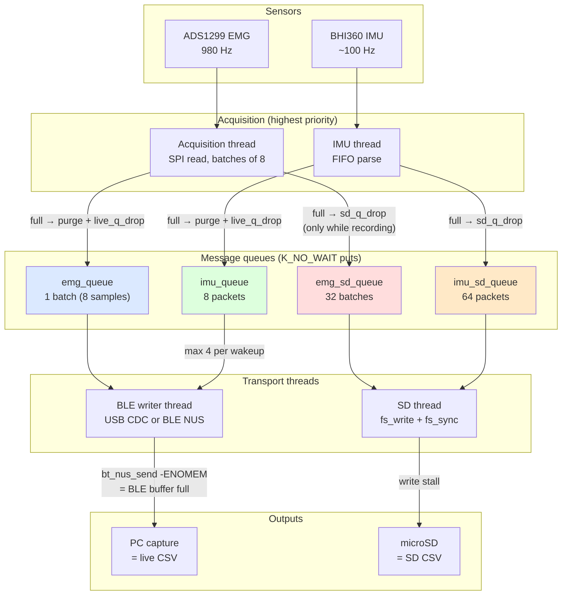

# Sample path and loss points

Simplified data flow for the `bluetooth_integration` firmware, from the
sensors to the recorded CSVs. Queue depths and drop behaviour are from
[`app/src/threads.cpp`](../app/src/threads.cpp) and
[`drivers/bhi360/bhi360_driver.cpp`](../drivers/bhi360/bhi360_driver.cpp).

## Where samples are lost

| Stage | Mechanism | Counter |
|-------|-----------|---------|
| EMG live queue | `emg_queue` holds only **1 batch**; on a full put, all queued batches are purged and counted (`k_msgq_purge`) | `emg_live_queue_drops` |
| IMU live queue | same purge-on-full for `imu_queue` (8 packets) | `imu_live_queue_drops` |
| EMG SD queue | `emg_sd_queue` (32 batches) full → batch dropped from SD only | `emg_sd_queue_drops` |
| IMU SD queue | `imu_sd_queue` (64 packets) full → packet dropped from SD only | `imu_sd_queue_drops` |
| BLE transmission | `bt_nus_send` is non-blocking; `-ENOMEM` = BLE TX buffers full, group dropped | `emg/imu_send_enomem` |
| SD card write | `fs_write`/`fs_sync` stalls; the SD queues absorb latency, overflow shows up as SD queue drops | — |

Notes:

- The live and SD queues are **independent copies**: a sample can be lost on
  one path and still arrive on the other. The SD CSV is the backup record.
- SD queue puts happen only while `sd_recording` is on (Button 1); the live
  path always runs.
- The log lines (`EMG/s: collected=... live_q_drop=... sd_q_drop=...`) are
  written by the log backend into a separate `session_XXXX.log` on the card.
